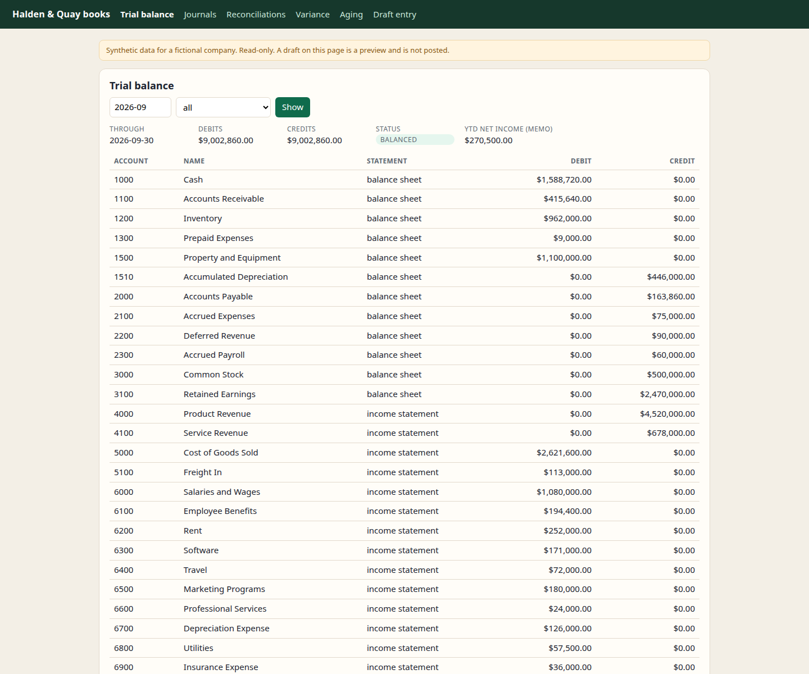
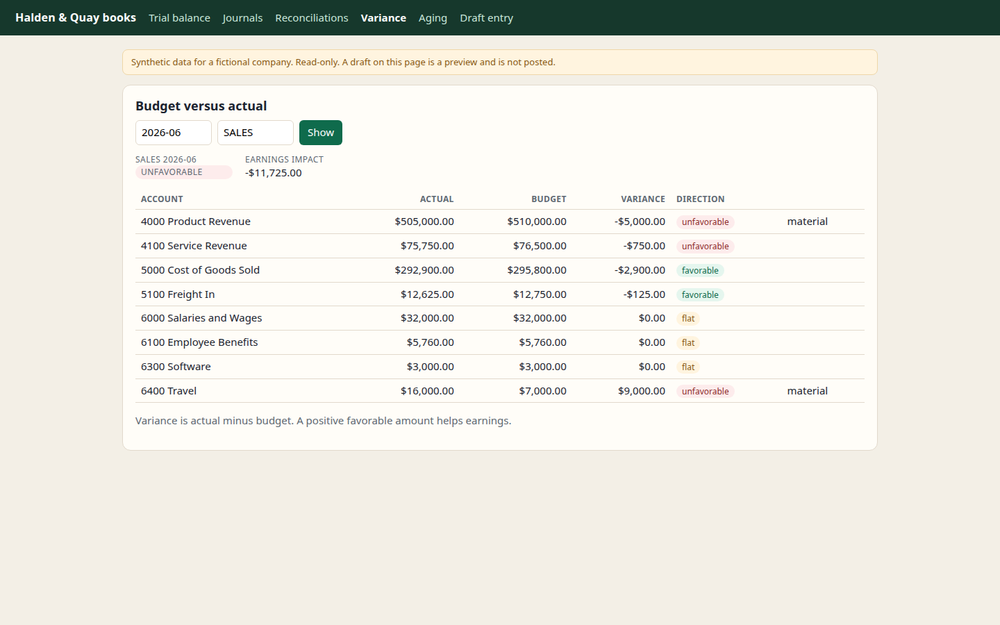
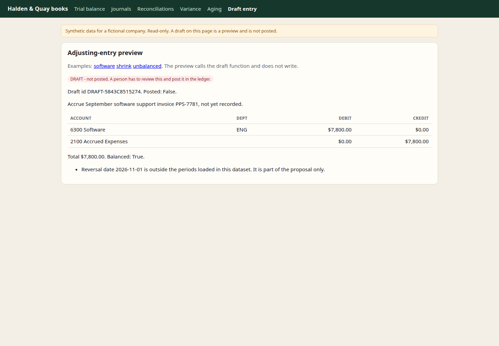
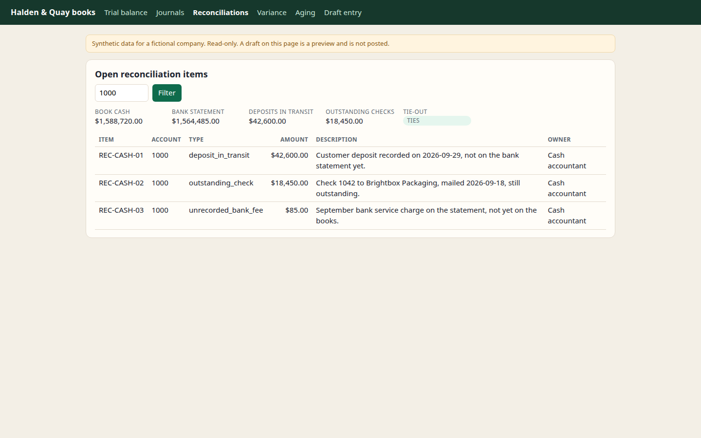
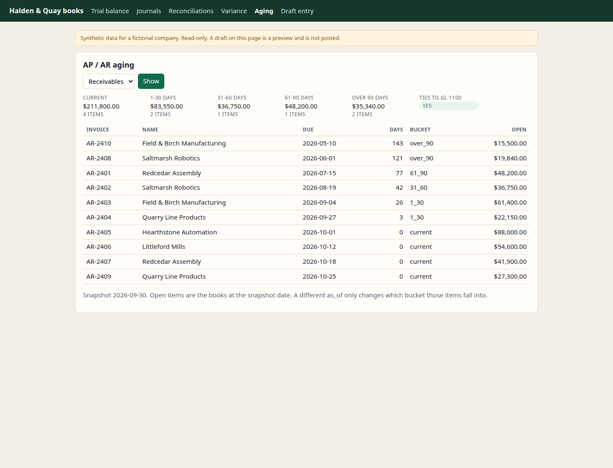
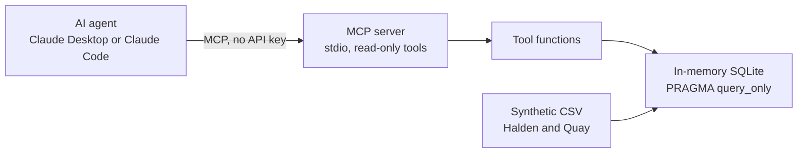

# poc.mcp-finance-tools

Ask an agent for a trial balance, an open reconciliation, a budget variance, or an aging — and get an adjusting entry a person still has to post. The books are synthetic. There is no API key, and this server never writes a ledger.

[](https://github.com/tishan-perera/poc.mcp-finance-tools/actions/workflows/ci.yml)
[](LICENSE)
[](https://www.python.org/downloads/)

> **Synthetic data.** Halden & Quay Supply, Inc. is a fictional US distributor. Every amount, vendor, customer, and invoice in this repo is invented. This is not a real ledger and not financial advice.

> **MCP** (Model Context Protocol) is an open standard for plugging tools into an AI assistant. The assistant sees a list of tools, calls one, and gets JSON back.



## What it does

| Tool | Question it answers |
|---|---|
| `lookup_gl_account` | What is this account, and what is its balance? |
| `get_trial_balance` | Does the pre-close trial balance foot for this period? |
| `search_journal_entries` | Which posted entries mention this text, account, department, or amount? |
| `list_open_reconciliations` | What is still open, and does cash tie to the bank statement? |
| `get_budget_variance` | Where did actuals move against budget, and did that help earnings? |
| `get_ap_ar_aging` | How old are the open payables or receivables, and do they tie to the control account? |
| `draft_adjusting_entry` | What would a balanced adjusting entry look like? Returns a draft. Does not post. |

The dataset is a calendar year-to-date close through 30 September 2026. Income-statement accounts are still open, so year-to-date net income ($270,500) is a memo, not a closing entry. The September trial balance foots.

### Safe by design

- **Read-only.** The ledger object has no write methods. After the CSV is loaded, SQLite is switched to `PRAGMA query_only`, and a test checks that an insert is rejected. Every tool is marked `readOnlyHint: true`.
- **Drafts, not postings.** `draft_adjusting_entry` checks the accounts, the departments, and that debits equal credits. The response says `DRAFT - not posted` and `posted: false`. An unbalanced proposal comes back as an error with `posted: false`. The CSV is unchanged.
- **Synthetic books only.** One fictional company, USD, no bank login, no ERP, no API key.

## Quick start

Needs [uv](https://docs.astral.sh/uv/) and Python 3.10 or newer. No API key, no account, no network call at runtime.

```bash
git clone https://github.com/tishan-perera/poc.mcp-finance-tools
cd poc.mcp-finance-tools
uv sync
uv run pytest -q
```

See the tools work without an AI client:

```bash
uv run python scripts/demo_client.py
```

That script starts the server, calls every tool the way an agent would, and prints the JSON. Saved output: [docs/transcript.md](docs/transcript.md).

A one-file viewer (Python standard library only) shows the same results in a browser:

```bash
uv run mcp-finance-viewer
# http://127.0.0.1:8765
```

| June Sales variance | Draft, not posted |
|---|---|
|  |  |
| **Cash reconciliation** | **Receivables aging** |
|  |  |

## Connect an agent

The server speaks MCP over stdio. The host starts it as a subprocess. Nothing listens on a port, and the config has no secret.

### Claude Code

From this directory:

```bash
claude mcp add finance-tools -- uv run --directory "$(pwd)" mcp-finance-tools
```

Or copy [`.mcp.json.example`](.mcp.json.example) to `.mcp.json` and replace the path. Project-scoped servers live in `.mcp.json`. User-scoped servers live in `~/.claude.json`.

### Claude Desktop

Claude Desktop reads `claude_desktop_config.json`:

| System | Path |
|---|---|
| macOS | `~/Library/Application Support/Claude/claude_desktop_config.json` |
| Windows | `%APPDATA%\Claude\claude_desktop_config.json` |
| Linux | `~/.config/Claude/claude_desktop_config.json` |

The Dock or Start Menu launch does not load your shell `PATH`. Use the absolute path from `which uv`.

```json
{
  "mcpServers": {
    "finance-tools": {
      "command": "/absolute/path/to/uv",
      "args": ["run", "--directory", "/absolute/path/to/poc.mcp-finance-tools", "mcp-finance-tools"]
    }
  }
}
```

Restart Claude Desktop after saving. There is no `env` block because there is no API key.

Questions that exercise the books:

- "Give me the September 2026 trial balance and tell me if it foots."
- "Find the journal entry for the August heat wave."
- "Which cash reconciliation items are still open, and does the bank tie?"
- "For Sales in June 2026, which budget variances are material?"
- "Age receivables as of the close and confirm they tie to the GL."
- "Draft an accrual for the unrecorded Paper & Pixel invoice REC-AP-01. Do not post it."

## How it fits together



`server.py` registers the tools. `tools.py` is ordinary Python, which is what the tests call. `ledger.py` is the only module that touches SQLite, and only to read. The CSV under [`src/mcp_finance_tools/data/`](src/mcp_finance_tools/data/) is the ledger. [`scripts/generate_synthetic_books.py`](scripts/generate_synthetic_books.py) is the story that produces it: opening balances, nine months of activity, a budget, open invoices that tie to the control accounts, and a bank statement that ties after deposits in transit, outstanding checks, and one unrecorded fee.

A draft for a closed period is still only a draft. The tool says the period is closed and leaves it closed. With `auto_reverse` (the default) the response also includes the reversing proposal for the first of the next month, again unposted.

## Limits

- One fictional company, USD, calendar fiscal year, pre-close through September 2026. October is open and has no posted activity.
- No consolidation, no tax, no multi-currency, no allocations. Cost of goods and freight sit on Sales so that department's margin is visible. They are not pushed down any further.
- Open AP and AR items are the 30 September snapshot. They tie in total to accounts 2000 and 1100. They are not a full invoice history. Passing another `as_of` only rebuckets that same snapshot.
- Reconciliation items include off-book support (an unrecorded invoice, a count shortage, a bank fee). Listing them does not post them.
- Journal search returns at most 50 entries. Aging returns at most 100 documents. Bucket totals still cover every match.
- The server has no NetSuite, SAP, bank, or spreadsheet connector. Pointing it at a real export is outside this demo.
- Figures are invented. They are not a forecast, a filing, or advice.

## Project layout

Each folder has its own README.

| Folder | What's in it |
|---|---|
| [src/mcp_finance_tools/](src/mcp_finance_tools/README.md) | Server, tools, ledger, viewer, and the tool table |
| [src/mcp_finance_tools/data/](src/mcp_finance_tools/data/README.md) | Synthetic CSV books |
| [tests/](tests/README.md) | What each test checks |
| [scripts/](scripts/README.md) | Generator and the demo client |
| [docs/](docs/README.md) | Transcript and screenshots |
| [.github/](.github/README.md) | CI: pytest, ruff, and a gitleaks secret scan |

## License

MIT, see [LICENSE](LICENSE).
