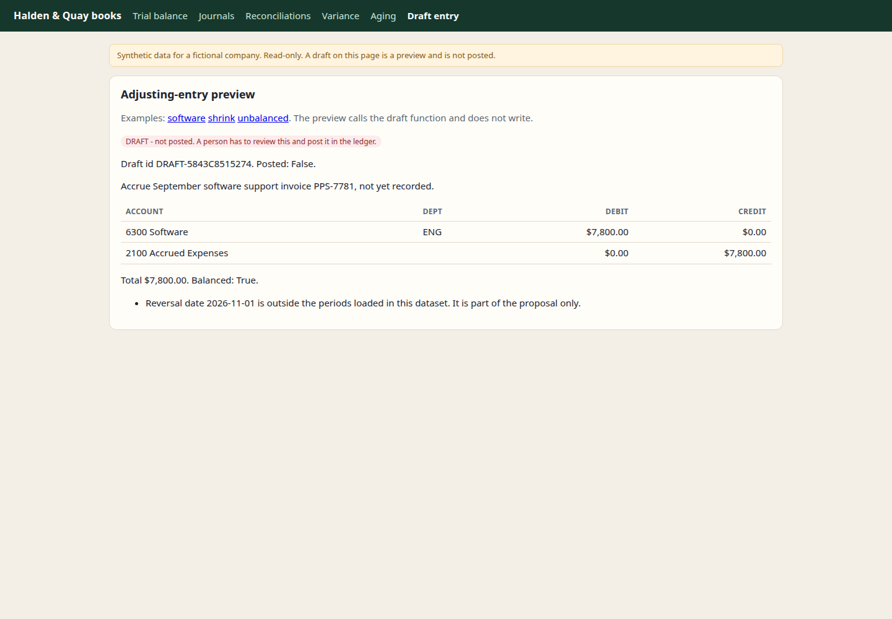

# docs/

Things to look at without starting an agent.

| File | What it is |
|---|---|
| [transcript.md](transcript.md) | Real output of [`scripts/demo_client.py`](../scripts/demo_client.py): an MCP client over stdio, the tool list, and the JSON each call returned. |
| [screenshots/](screenshots/) | Headless-browser captures of the local viewer, using the synthetic books. |

| File | Shows |
|---|---|
| [viewer-trial-balance.png](screenshots/viewer-trial-balance.png) | September trial balance, debit column equal to credit column |
| [viewer-variance.png](screenshots/viewer-variance.png) | June Sales: revenue miss and the expo travel overage |
| [viewer-recon.png](screenshots/viewer-recon.png) | Cash items and a bank tie-out that ties |
| [viewer-aging.png](screenshots/viewer-aging.png) | Receivables aging that ties to account 1100 |
| [viewer-draft.png](screenshots/viewer-draft.png) | An adjusting-entry preview marked not posted |

Refresh the transcript with `uv run python scripts/demo_client.py > docs/transcript.md`.
