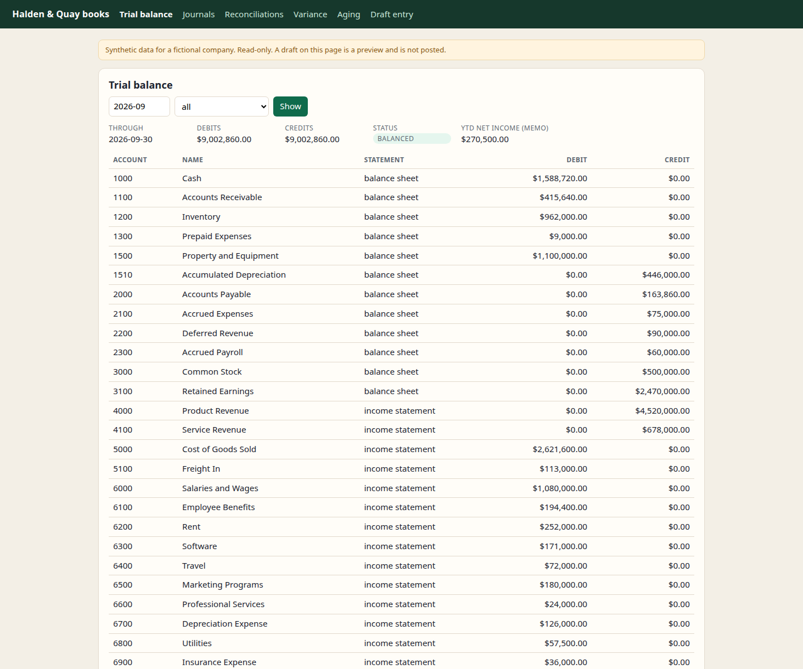
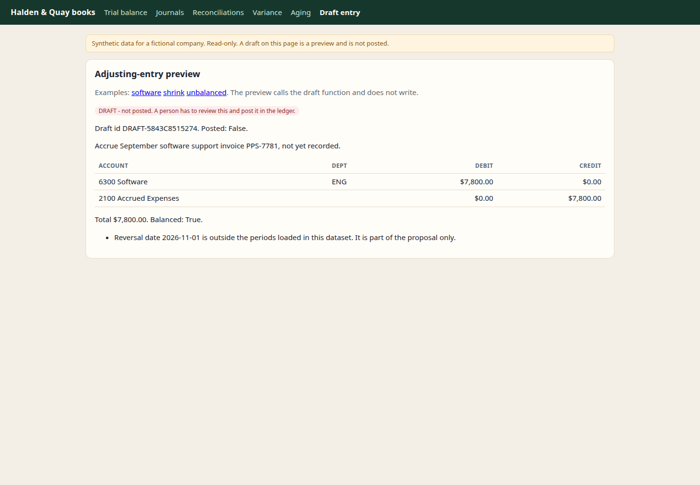

# mcp_finance_tools/

An agent talks to `server.py`. The other modules feed it. None of them post a journal entry.

| File | What it does |
|---|---|
| [server.py](server.py) | MCP server. Registers the tools and marks each one read-only. Command: `mcp-finance-tools`. |
| [tools.py](tools.py) | The tool logic as plain functions, so tests can call them without MCP. |
| [ledger.py](ledger.py) | Loads the CSV into an in-memory SQLite database and sets `PRAGMA query_only`. |
| [money.py](money.py) | Dollar amounts as integer cents, shown as decimal strings. |
| [viewer.py](viewer.py) | A small read-only page over the same functions. Command: `mcp-finance-viewer`. |
| [data/](data/) | The synthetic CSV ledger. |

## Tools

Every tool is read-only. `draft_adjusting_entry` returns a proposal with `posted: false`.

| Tool | Input | Returns |
|---|---|---|
| `lookup_gl_account` | `query`, optional `period` | Account master data and balances. An exact code wins; otherwise a case-insensitive name or code match. |
| `get_trial_balance` | `period`, optional `statement` | Pre-close trial balance. Debit and credit totals cover the whole book. Net income is a memo. |
| `search_journal_entries` | optional text, account, department, period, source, amount bounds, `limit` | Posted entries and their lines. |
| `list_open_reconciliations` | optional account, period, `include_cleared` | Open items. Cash also returns the bank tie-out. |
| `get_budget_variance` | `period`, optional department, `ytd`, materiality | Actual, budget, variance, and whether the variance helps earnings. |
| `get_ap_ar_aging` | `ap` or `ar`, optional `as_of`, name, `limit` | Aging buckets. On the snapshot date the open total ties to the control account. |
| `draft_adjusting_entry` | period, memo, lines, optional support item | A balanced draft and, by default, a reversing proposal. Nothing is written. |

## Screenshots

| Trial balance | Draft, not posted |
|---|---|
|  |  |

More in [docs/](../../docs/).
